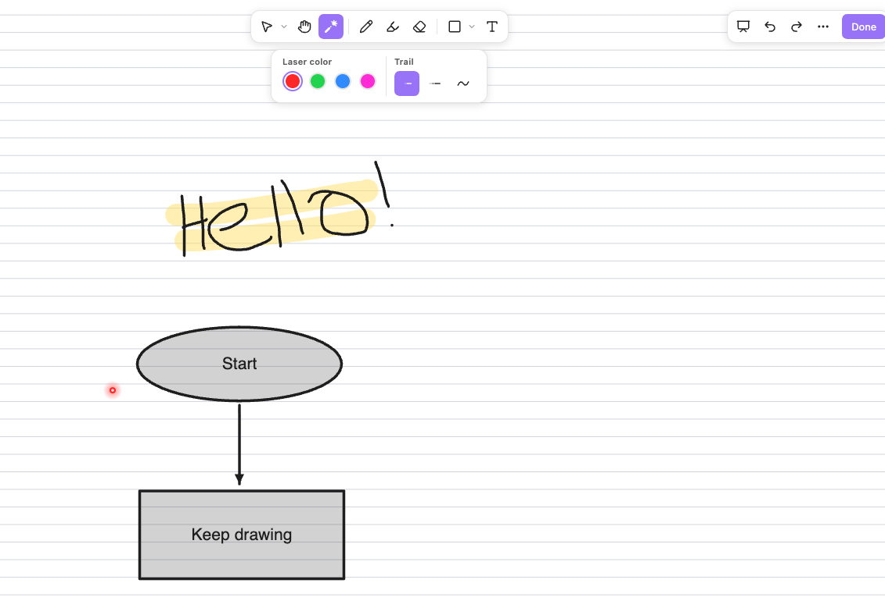

# Quick Sketch

Sketch, diagram and present right inside your notes. Quick Sketch adds a drawing editor to Obsidian that works with a mouse, a trackpad, or an Apple Pencil, and saves every drawing as a plain SVG file that embeds in your notes like any other image.

## Features

- **Freehand ink** with pressure sensitivity (Apple Pencil and other styluses), and a **highlighter** that stays underneath your ink.
- **Shapes and arrows**: rectangles, ellipses, diamonds, lines and arrows. Arrows attach to shapes and follow them when they move. Shapes can hold a text label.
- **Shape recognition**: draw a rough shape and hold the pen still at the end, and it snaps to a clean line, rectangle, ellipse or diamond.
- **Text**, **dashed and dotted lines**, **fills**, and a color palette you can extend.
- **Select and lasso** to move, resize, restyle, duplicate, copy and paste.
- **Images**: paste, drag in, or insert a picture and draw on top of it.
- **Background paper**: dots, grid or lines.
- **Presentation mode** with a **laser pointer** that follows your mouse or pencil.
- **Export** to PNG, SVG or PDF, or copy as PNG or SVG.
- Made for the iPad as much as the desktop: palm rejection, pinch to zoom, and two-finger panning.

## Getting started

1. Open a note and put the cursor where the drawing should go.
2. Run **Quick Sketch: New drawing** from the command palette, or click the pencil icon in the ribbon.
3. A new SVG file is created, embedded at the cursor, and opened in the editor. Draw, then press **Done**.

To edit a drawing later, press **Edit** in its top-right corner. On desktop the button appears when you hover over the drawing; on iPad and iPhone it's always shown.

Drawings save automatically while you work.

## Tools

| Tool | Key | What it does |
| --- | --- | --- |
| Select | V | Click to select, drag to move; drag on empty space to select a box. Double-click a shape or text to edit its label or text. |
| Lasso | F | Draw around things to select them. |
| Pan | Space (hold) | Drag the canvas. |
| Laser pointer | K | A glowing pointer and fading trail for presenting. Draws nothing. |
| Pen | P | Freehand ink. |
| Highlighter | H | Translucent ink that stays under everything else. |
| Eraser | E | Erases whole strokes and shapes it touches (but not images). |
| Rectangle, ellipse, diamond | S, C, D | Drag to draw. Hold Shift for squares and circles. |
| Line, arrow | L, A | Drag to draw. Hold Shift to snap the angle. Drop an end on a shape to attach it. |
| Text | T | Click to type. |

The select and shape buttons have a small arrow next to them that lists their variants.

When a tool or a selection is active, the panel on the right shows its options: color, size, line style, fill and arrowheads (hover over a group to see its name). Drag it by the dots at its top to put it anywhere; double-click the dots to put it back.

### Tips

- **Shape recognition**: with the pen, draw a shape and keep the pen still for about half a second at the end. Strokes that don't look like a shape are left as they are. You can turn this off in the settings.
- **Images**: paste with Cmd/Ctrl+V, drag a file onto the canvas (desktop), or use **Insert image…** in the ⋯ menu (on iPad it opens your photos and files). Images sit under your ink, so you can annotate screenshots. The eraser skips images; select an image and press Delete to remove it.
- **Background paper**: pick plain, dotted, grid or lined paper for each drawing in the ⋯ menu. By default the paper only shows while editing; a setting adds it to the saved drawing and exports too.
- **Alt/Option-drag** a selection to drag a copy.

## Presenting

Press the **Present** button (or run **Toggle presentation mode**). The toolbars hide, the drawing fits the screen, and the laser pointer turns on. On desktop the drawing goes full screen.

The laser follows your mouse, or your Apple Pencil while it touches the screen. In the laser's options (before presenting) you can choose its color and how long its trail lasts:

- **Short** or **long** trails fade out on their own.
- **Hold** keeps the trail until your next stroke, for circling something while you talk about it. Press Esc to clear it.

Press Esc or the ✕ in the corner to stop presenting.

## Exporting

From the ⋯ menu, or the command palette:

- **Copy as PNG** / **Copy as SVG** to the clipboard.
- **Export PNG…**, **Export SVG…**, **Export PDF…** save a file wherever you choose: the system save dialog on desktop, or the share sheet on iPad and iPhone ("Save to Files" lets you pick a folder).

The PDF is a single page the size of the drawing, with the drawing embedded as a high-resolution image.

## Keyboard shortcuts

| Shortcut | Action |
| --- | --- |
| Cmd/Ctrl+Z, U | Undo |
| Cmd/Ctrl+Shift+Z, Cmd/Ctrl+Y | Redo |
| Cmd/Ctrl+A | Select all |
| Cmd/Ctrl+C, X, V | Copy, cut, paste |
| Cmd/Ctrl+D | Duplicate |
| Delete, Backspace | Delete the selection |
| Arrow keys (with Shift) | Nudge the selection 1 px (10 px) |
| Esc | Clear the selection, clear the laser, or stop presenting |
| B, R, O, G | Black, red, orange or green ink |

**Navigating**: scroll to pan and Cmd/Ctrl+scroll (or pinch) to zoom. Middle- or right-drag also pans. On a touchscreen, drag with one finger to pan and pinch with two to zoom. Fingers never draw, so your palm can rest on the screen while you write with the pencil.

## Commands

- New drawing
- Toggle presentation mode
- Insert image into drawing
- Copy drawing as PNG / SVG
- Export drawing as PNG / SVG / PDF
- Toggle input diagnostics (shows input latency numbers, for troubleshooting)

## Settings

- **New drawings**: where they're created (your attachment folder or a folder of your choice) and how they're named.
- **Defaults**: the tool, color and stroke size a drawing opens with; pen pressure; shape recognition.
- **Background**: the paper for new drawings, and whether it's saved with the drawing.
- **Export**: PNG and PDF resolution, and a white or transparent PNG background.

## How drawings are stored

Each drawing is an ordinary `.svg` file in your vault, cropped to what you drew. Notes embed it like any image (`![[Drawing.svg]]`), so it shows up in reading view, Live Preview, publishing and other apps. Everything needed to keep editing it lives in the same file; there's no separate data file. Pasted images are stored inside the SVG.

## Privacy

Quick Sketch works entirely offline. It makes no network requests and collects no data.

It only writes outside your vault when you export a file and choose a location for it in the save dialog or share sheet.

## Installation

**From Obsidian**: open **Settings → Community plugins → Browse**, search for "Quick Sketch", then install and enable it.

**Manually**: download `main.js`, `manifest.json` and `styles.css` from the [latest release](../../releases/latest) and put them in `<your vault>/.obsidian/plugins/quick-sketch/`. Then reload Obsidian and enable the plugin under **Settings → Community plugins**.

## Credits

Quick Sketch has no runtime dependencies besides Obsidian itself: the plugin bundles no third-party libraries, only the icons below.

### Included in the plugin

| Project | Used for | License |
| --- | --- | --- |
| [Lucide](https://lucide.dev) | Toolbar icons | ISC (notice below) |

### Provided by Obsidian

| Project | Used for | License |
| --- | --- | --- |
| [Obsidian API](https://github.com/obsidianmd/obsidian-api) | The plugin API (views, menus, settings, vault access) | MIT |
| [Moment.js](https://momentjs.com) | Date formatting in new drawings' file names (bundled with Obsidian) | MIT |

### Used to build the plugin

These tools turn the source code into `main.js`; none of them is part of the released plugin.

| Project | Used for | License |
| --- | --- | --- |
| [esbuild](https://esbuild.github.io) | Bundling | MIT |
| [TypeScript](https://www.typescriptlang.org) | Type checking and compiling | Apache-2.0 |
| [builtin-modules](https://github.com/sindresorhus/builtin-modules) | Build configuration | MIT |
| [@types/node](https://github.com/DefinitelyTyped/DefinitelyTyped) | Type definitions for the build script | MIT |

### Lucide license

Toolbar icons are from [Lucide](https://lucide.dev), used under the ISC License:

> Copyright (c) for portions of Lucide are held by Cole Bemis 2013-2022 as part of Feather (MIT). All other copyright (c) for Lucide are held by Lucide Contributors 2022.
>
> Permission to use, copy, modify, and/or distribute this software for any purpose with or without fee is hereby granted, provided that the above copyright notice and this permission notice appear in all copies.
>
> THE SOFTWARE IS PROVIDED "AS IS" AND THE AUTHOR DISCLAIMS ALL WARRANTIES WITH REGARD TO THIS SOFTWARE INCLUDING ALL IMPLIED WARRANTIES OF MERCHANTABILITY AND FITNESS. IN NO EVENT SHALL THE AUTHOR BE LIABLE FOR ANY SPECIAL, DIRECT, INDIRECT, OR CONSEQUENTIAL DAMAGES OR ANY DAMAGES WHATSOEVER RESULTING FROM LOSS OF USE, DATA OR PROFITS, WHETHER IN AN ACTION OF CONTRACT, NEGLIGENCE OR OTHER TORTIOUS ACTION, ARISING OUT OF OR IN CONNECTION WITH THE USE OR PERFORMANCE OF THIS SOFTWARE.

## License

[MIT](LICENSE)
